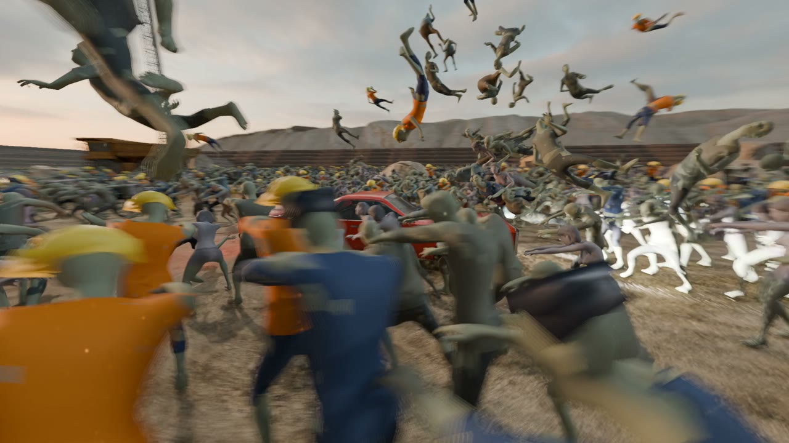
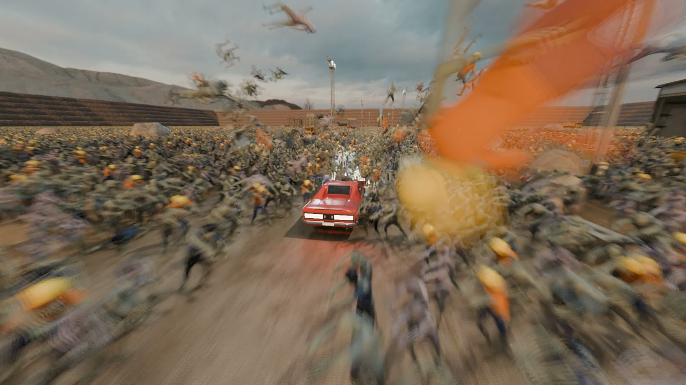
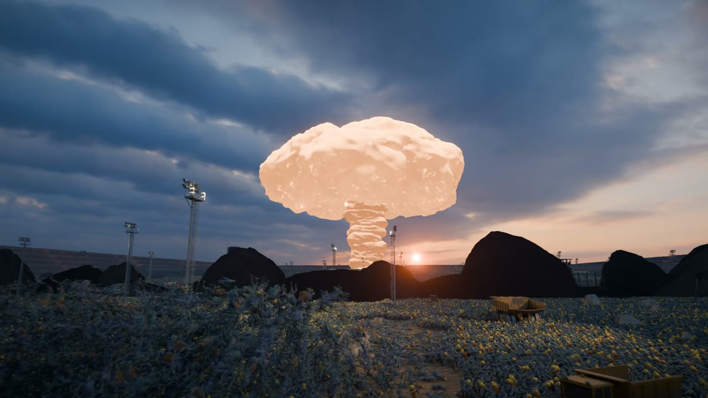

# A million zombies in vork

The scripts behind our zombie horde clips: a red muscle car ploughing through **1,000,000 simulated zombies** in a quarry at dusk, with bullet time, a camera that rises to show the whole horde, and in the second clip a nuclear strike.

Everything here generates a scene file for [vork](https://github.com/voyager-so/vork), which simulates and path-traces it. We didn't make vork. This repo is only the scene code we wrote on top of it.





## The clips

| Clip | Generator | Length | Zombies | Render on an RTX 5090 (1080p, final quality) |
|---|---|---|---|---|
| Horde: drive, bullet time, rise | `horde/gen-horde.mjs` | 12 s | 1,000,000 | 288 frames in 21 min (4.4 s per frame) |
| Nuke: horde, sky strikes, mushroom cloud | `horde/gen-nuke.mjs` | 25 s | 1,000,000 | 600 frames in 39 min (3.9 s per frame) |
| Quarry jump (our first vork test) | `quarry-jump/` | 13.5 s | none | 324 frames in 48 s |

The same quarry jump takes 92 s on an RTX 3090, so the 5090 is about 1.9× faster. Path-traced 1080p stills at 128 samples took 55 s on the 3090 and 31 s on the 5090.

## How it works

### 1. Baking the zombies (Blender)

vork instances meshes, but it can't deform each instance on its own: per-instance skinning, displacement or morph targets need memory for every copy, and a million copies used more than 20 GB of RAM. So the animation is baked into separate meshes instead:

- `bake/bake_horde.py` loads a rigged zombie in Blender, applies our recolour (`bake/creatures/kinds.json`), decimates it to about 2,900 triangles and writes **16 static poses of the walk cycle**, plus a "launched" pose (flailing, centred for spinning) and a "dead" pose.
- Five kinds (classic, woman, fat, cop, road worker) come from two models; the variants share a model and change clothes and size.
- A 450-triangle copy of each kind is used for the bodies in the air and on the ground, which keeps the scene under vork's limit of about 4.3 billion triangle instances.

### 2. The crowd simulation (Slang compute, inside vork)

The simulation runs on the GPU as vork compute programs (`horde/sim/`), with fixed 1/30 s ticks:

- **tick** advances a stored simulation clock by `dt × speed(t)`. Bullet time is just a speed curve that drops to 0.02 and comes back, so the rendering never stops and motion blur still works.
- **grid / advance**: zombies sit in a 2 m spatial grid. Each walks towards the road, avoids its neighbours and the props (excavators, haul trucks, the crusher plant), and stays on the terrain height field. The ones in the car's path are hit, thrown with spin and land as bodies.
- **place / commit**: each zombie picks one of the baked walk poses from its walking phase and writes its position, rotation and scale into that pose's instance list. Every pose node gets the rows of the zombies currently in that pose; the rest are scaled to zero.
- Everything random is hashed from the zombie's ID and a seed, so a given frame always looks the same, whatever the render order.

The nuke version adds sky strikes (blast impulses at set times and places), a shockwave ring that throws or vaporises zombies as it passes, and a camera corridor so the low camera doesn't clip through bodies.

### 3. The shot (generated JSON)

`gen-horde.mjs` and `gen-nuke.mjs` build the whole scene file in JavaScript:

- the quarry: a procedural terrain with benches, a road down the middle and textured materials;
- the props and rocks, packed from our game's quarry props by `horde/props.mjs` (`horde/layout.mjs` places them);
- the car, keyframed along the road with wheel spin and a buck when it hits the crowd;
- the camera: a low tracking shot, an orbit around the car during bullet time, then a rise to show the scale. The JS samples the same clock curve as the simulation, so camera and crowd stay in sync;
- lights: a sunset sky HDRI, a low sun and 31 floodlight masts that light pockets of the crowd;
- a compositor: depth haze, bloom and a colour grade (`zombie_look.slang` recolours the zombies by body height, so clothes read at a distance).

The nuke adds `horde/cloud.mjs`: vork has no volumes, so the fireball and mushroom are about 200 lumpy, noise-displaced blobs animated in JS (fireball, rolling cap ring, stem, base surge and the shockwave dust front), with a custom surface program that glows in the cracks and on the underside.

## Running it

You need vork, Node 20+, Blender 4.x and ffmpeg. The first 6 s of every scene only warm up the simulation, so renders start at frame 144.

```bash
npm install
bake/bake.sh <folder with the zombie models>        # writes horde/out/
ASSETS=<game assets folder> npm run props            # props and rocks
ASSETS=<game assets folder> RES=1920x1080 node horde/gen-horde.mjs 1000000
render/render.sh horde/out/scene.json 144 431 horde.mp4
```

For the nuke: `node horde/gen-nuke.mjs 1000000`, then render frames 144 to 743. On Windows use `render/render.ps1`.

### What isn't included

The scripts read files that aren't in this repo, so they won't run as they are without swapping some in:

- **vork.** It's source-available under its own licence, not open source, so get it from its repo.
- **Zombie models**: download them yourself (both are CC0). "Male City Zombie" by Rikindle3D (zombie, fat, cop, road worker) and "Basic Female" by EmoPreben (zombie woman), both on OpenGameArt. Unpack them into folders named `oga-cityzombie` and `oga-female`. Their animation clips look like Mixamo downloads, which is one more reason we don't redistribute the baked meshes.
- **Game assets** (the `ASSETS` folder): the quarry props, terrain textures and the car come from our game, Destruction Cars, and stay private. Swap in your own: the props are listed in `horde/layout.mjs`, and the car is any glTF with a material named `paint` (`car/decompress.mjs` makes a vork-readable copy, `car/paint.mjs` paints it red; save it as `horde/out/charger-hot.glb`).
- **Sky**: "Sunset in the Chalk Quarry" from Poly Haven (CC0), saved as `horde/out/sky.hdr`.

## Notes and known issues

- This is clip code, not a library: numbers are tuned by eye for these shots.
- The nuke clip packs a million zombies into the area of an earlier 400k test, so the opening is too crowded, and one shockwave dust puff passes in front of the low camera. Widening `AREA` in `gen-nuke.mjs` and skipping dust near the camera fixes both.
- vork tips: the `material_ranges` count is in indices, not triangles; instance rotations must be unit quaternions even at install; and on Linux, turn off MangoHud (`MANGOHUD=0`) or vork can hang at start-up.

## Licence

MIT for the code in this repo. vork, the models and the game assets keep their own licences.
